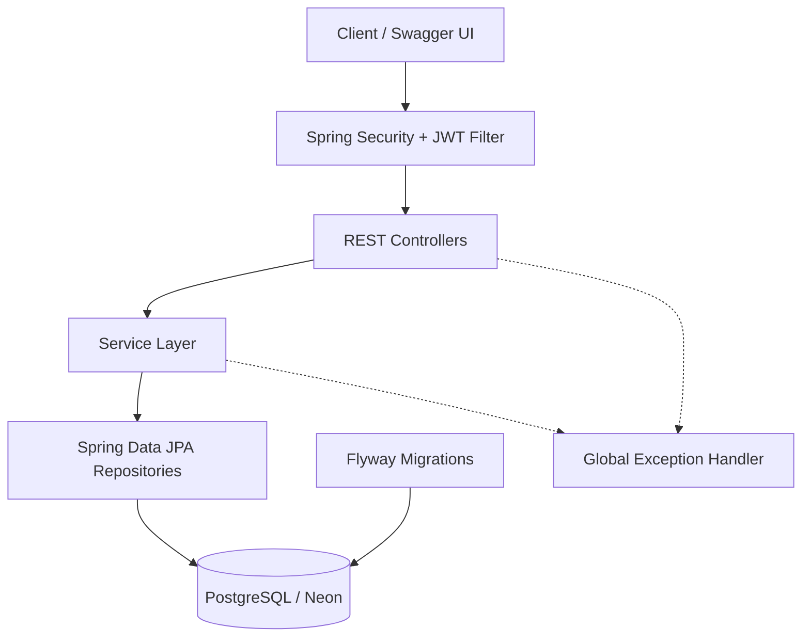
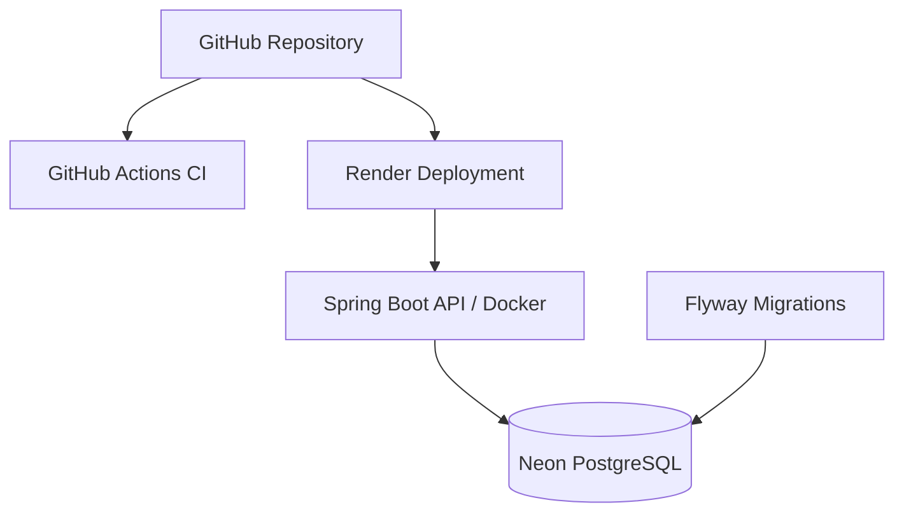

# SecureBankCore

**Secure Banking REST API | Java 21 · Spring Boot · PostgreSQL · JWT · Docker**

SecureBankCore is a banking backend application built with Java 21 and Spring Boot. It simulates core banking operations, including customer management, bank account management, deposits, withdrawals, transfers, and transaction history.

The project demonstrates backend engineering practices such as layered architecture, RESTful API design, JWT authentication, role-based authorization, transaction management, database migrations, automated testing, containerization, and continuous integration.

The application is deployed on Render with a PostgreSQL database hosted on Neon.

Live API Documentation: https://securebankcore.onrender.com/swagger-ui/index.html

Source Code: https://github.com/johnnytelles77/SecureBankCore

## Features

- User registration and management
- Bank account creation and management
- Deposits and withdrawals
- Account-to-account transfers
- Transaction history
- JWT authentication
- Role-based authorization with ADMIN and CUSTOMER roles
- Account ownership validation
- Request validation
- Global exception handling
- DTO-based request and response models
- Swagger / OpenAPI documentation
- Unit testing
- Integration testing
- Docker and Docker Compose support
- PostgreSQL persistence


## Tech Stack

| Category | Technologies |
|---|---|
| Language | Java 21 |
| Backend Framework | Spring Boot 3, Spring Web |
| Security | Spring Security, JWT, BCrypt |
| Persistence | Spring Data JPA, Hibernate |
| Databases | PostgreSQL, H2 (testing) |
| Database Migrations | Flyway |
| API Documentation | Swagger UI, OpenAPI |
| Testing | JUnit 5, Mockito, MockMvc |
| Build Tool | Maven |
| Containerization | Docker, Docker Compose |
| CI | GitHub Actions |
| Cloud Hosting | Render, Neon PostgreSQL |
| Version Control | Git, GitHub |


## Architecture

SecureBankCore follows a layered architecture that separates HTTP request handling, business logic, data access, and persistence.



### Layer Responsibilities

- **Controllers:** Expose REST endpoints and handle HTTP requests and responses.
- **Services:** Implement business rules for users, accounts, and transactions.
- **Repositories:** Provide database access through Spring Data JPA.
- **Security:** Authenticate JWT tokens and enforce authorization rules.
- **Database:** Persist banking data in PostgreSQL.
- **Flyway:** Manage versioned database schema migrations.
- **Exception Handling:** Convert application exceptions into consistent HTTP error responses.


## Deployment

SecureBankCore is deployed using a cloud-based infrastructure.

| Component | Technology |
|---|---|
| Backend hosting | Render |
| Database hosting | Neon PostgreSQL |
| Containerization | Docker |
| Database migrations | Flyway |
| Continuous Integration | GitHub Actions |
| API documentation | Swagger UI / OpenAPI |

### Production Architecture



### Live Documentation

[Swagger UI](https://securebankcore.onrender.com/swagger-ui/index.html)

The application uses environment variables to configure database credentials, JWT secrets, and the active Spring profile. The production environment enables Flyway migrations and Hibernate schema validation.

**Note:** Render's free instance may require additional time to respond after a period of inactivity.


## Security

SecureBankCore implements:
- JWT-based stateless authentication
- BCrypt password hashing
- Role-based authorization
- Protected API endpoints
- ADMIN and CUSTOMER roles
- Account ownership validation
- Environment-based JWT secret configuration.

Sensitive values such as JWT secrets and database credentials are managed through environment variables and are not committed to the repository.
  
## API Endpoints

### Authentication
```text
POST /auth/login
```
### Users
```text
POST   /users
GET    /users
GET    /users/{id}
PUT    /users/{id}
DELETE /users/{id}
```
### Accounts
```text
POST   /accounts
GET    /accounts
GET    /accounts/{id}
PATCH  /accounts/{id}/status
DELETE /accounts/{id}
```
### Transactions
```text
POST /transactions/deposit
POST /transactions/withdraw
POST /transactions/transfer
GET  /transactions/account/{id}
```


## Testing

SecureBankCore includes automated unit and integration tests to verify business logic, REST API behavior, and security rules.

### Testing Technologies

- **JUnit 5:** Test framework for Java.
- **Mockito:** Mocking dependencies to isolate business logic.
- **MockMvc:** Testing HTTP requests and responses without starting a real web server.
- **Spring Boot Test:** Integration testing with the Spring application context.
- **H2:** In-memory database used in testing.

### Test Coverage Areas

- Authentication and JWT security
- User and account management
- Deposits, withdrawals, and transfers
- Transaction history
- Role-based authorization
- Request validation and exception handling

### Running Tests

```bash
mvn clean verify
```

The project currently contains **80 automated tests**, all passing in the latest verified build.

GitHub Actions executes the Maven verification process automatically as part of the CI pipeline.


## Continuous Integration (CI)

SecureBankCore uses GitHub Actions to automatically build and test the application before changes are merged into the main branch.

### CI Workflow

1. Checkout the repository.
2. Set up Java 21.
3. Execute Maven build and verification.
4. Report the result as a GitHub status check.

```bash
mvn clean verify
```

The workflow is defined in `.github/workflows/ci.yml` and runs on pushes to `main` and Pull Requests targeting `main`.

### Branch Protection

The `main` branch is protected and requires:

- Changes to be submitted through Pull Requests.
- The required `build` status check to pass before merging.
- The Pull Request branch to be up to date with the target branch.

This process helps prevent unverified changes from entering the main branch.

## Running with Docker

### Prerequisites
- Docker
- Docker Compose

### 1. Clone the repository
```bash
git clone https://github.com/johnnytelles77/SecureBankCore.git
cd SecureBankCore
```
### 2. Create the environment file
```bash
cp .env.example .env
```
Edit .env and replace the example values with your own local credentials.
Example:
```env
JWT_SECRET=replace_with_your_secret
POSTGRES_DB=securebank
POSTGRES_USER=securebank_user
POSTGRES_PASSWORD=replace_with_your_password
```
### 3. Start the application
```bash
docker compose up --build
```
The API will be available at:
```text
http://localhost:8080
```
PostgreSQL runs internally on port 5432 and is exposed locally on:
```text
localhost:5433
```
### 4. Stop the application
```bash
docker compose down
```

## API Documentation

When the application is running, Swagger UI is available at:
```text
http://localhost:8080/swagger-ui/index.html
```

## Project Structure
```text
src/main/java/com/core/securebank
├── config
├── controller
├── dto
├── exception
├── model
├── repository
├── security
└── service
```

## Roadmap

### Completed

- [x] Banking REST API with user, account, and transaction management
- [x] JWT authentication, role-based authorization, and exception handling
- [x] Unit and integration testing (80 passing tests)
- [x] PostgreSQL persistence and Flyway database migrations
- [x] Docker containerization and GitHub Actions CI
- [x] Production deployment on Render with Neon PostgreSQL

### Future Development

#### Quality & Security
- [ ] Expand test coverage with JaCoCo and implement automated CD
- [ ] Enhance API security, auditing, and observability

#### Linux & DevOps
- [ ] Deploy and secure an Ubuntu Linux server using Docker
- [ ] Implement infrastructure monitoring and explore Kubernetes

#### Artificial Intelligence
- [ ] Build a Python microservice for transaction risk analysis
- [ ] Develop anomaly detection models with scikit-learn and PyTorch

#### Distributed Systems
- [ ] Explore Spring Cloud microservices and Java–Python integration
- [ ] Implement event-driven communication with Apache Kafka
